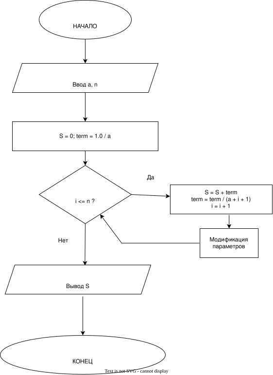

# Домашнее задание к работе 8

## Условие задачи

Вычислить с использованием цикла `for` значение ряда для заданных пользователем значений `a` и `n`:
\[
S = \frac{1}{a} + \frac{1}{a(a+1)} + ... + \frac{1}{a(a+1)...(a+n)}
\]
*(Индивидуальный вариант, задание 3)*

## 1. Алгоритм и блок-схема

### Алгоритм

1. Начало
2. Объявить переменные:
   * `a` — начальное значение знаменателя (вещественное).
   * `n` — количество шагов/предел (целое).
   * `S` — искомая сумма (вещественная, инициализируется нулем).
   * `term` — текущий член ряда (вещественная, инициализируется как `1.0 / a`).
   * `i` — счетчик цикла.
3. Ввести значения `a` и `n`.
4. Запустить цикл `for` от `i = 0` до `i = n`:
   * Добавить текущий член к сумме: `S = S + term`.
   * Подготовить следующий член: `term = term / (a + i + 1)`.
5. Вывести значение `S`.
6. Конец

### Блок-схема



## 2. Реализация программы
```text
#include <stdio.h>
#include <locale.h>
int main() {

    setlocale(LC_ALL, "RUS");
    double a;
    int n;

    printf("Введите значение a: ");
    scanf_s("%lf", &a);
    printf("Введите значение n: ");
    scanf_s("%d", &n);

    double S = 0.0;
    double term = 1.0 / a; 

    
    for (int i = 0; i <= n; i++) {
        S += term; 

        
        term = term / (a + i + 1);
    }

    printf("Сумма ряда S = %lf\n", S);

    return 0;
}
```
## 3. Результат работы программы
Введите значение a: 2
Введите значение n: 3
Сумма ряда S = 0.501984
## 4.Информация о разработчике
Шпагина Арина бИЦТ-262
